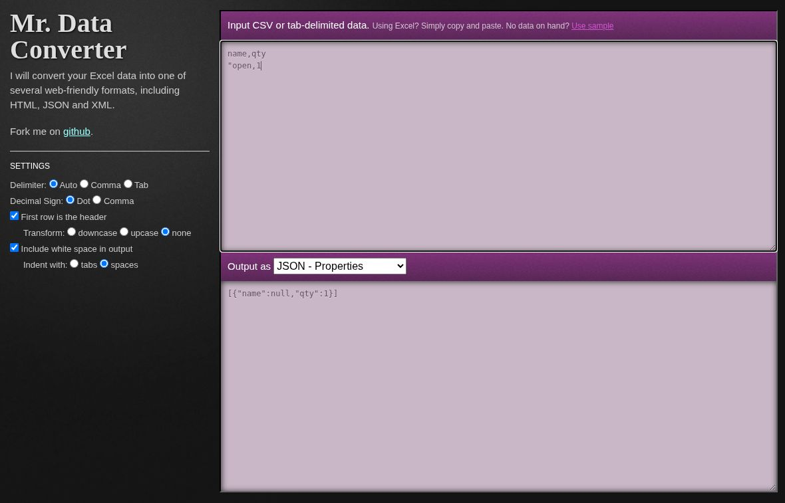
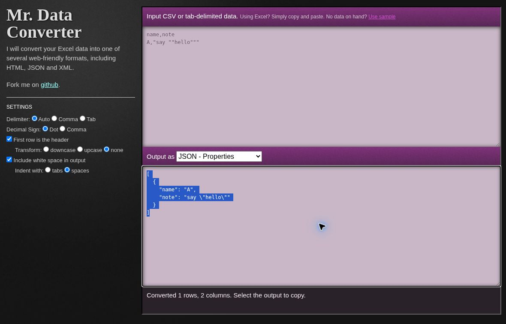
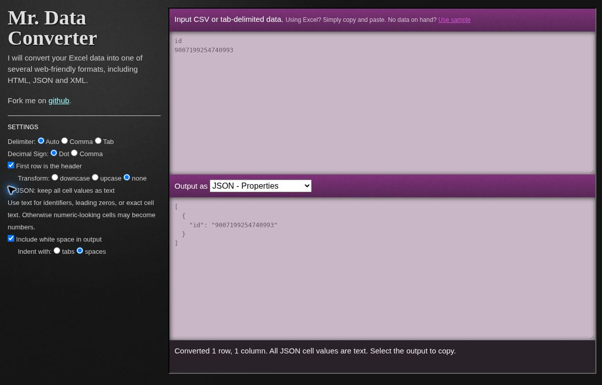

# A converter that says “done” can still lose the result

**A local, agent-assisted improvement study of a real open-source utility. Not a customer project, upstream contribution, or adoption study.**

[Mr. Data Converter](https://github.com/shancarter/mr-data-converter) turns spreadsheet/CSV input into web formats. This study uses commit `e5d6cb616eafe2d16beb6c7f0399d7ca5c142304`, dated 2014-08-27. The legacy code makes a compact, inspectable case, but is not representative of every modern product. Source and licenses are [retained](case-study/PROVENANCE.md).

## Start with the task, not the screen

The brief was to improve one consequential part of **paste → edit → convert → use the output**, keeping the product recognizable and preserving useful formats/settings. It did not name the defects to repair. Two fresh-context agents received the same brief and isolated source copies; one additionally read Product Excellence. The brief and assessment criteria were saved before the implementations completed.

Fresh inspection reproduced actual problems in the original source:

- Clearing input left the previous result visible.
- An unfinished quoted row silently became different data, without an error.
- A lone opening quote exceeded a bounded 100 ms parser execution window. This is a termination check, not a performance benchmark; the browser was not deliberately frozen.



## Repairing editing was necessary, but not sufficient

Both agents made the right broad choice: treat incomplete input as a recoverable state, preserve the user's work, separate diagnostics from machine-readable output, and clearly label a retained result as stale. Both repaired quote parsing, uneven-row handling, empty-input behavior, and input-event updates. Neither added dependencies or redesigned the product.

The difference appeared at the next step. In actual Chromium, the baseline announced successful conversion for a cell containing `say "hello"`, but its copied output failed `JSON.parse`. Backslashes could also become control characters, and duplicate keys could silently lose values. These were inherited serializer faults, not newly introduced by the baseline, but they still blocked the requested usable-result journey.

The skill-assisted implementation used JSON serialization, protected quoted text/backslashes, and rejected duplicate object keys with a recovery suggestion. Both actual clipboard contents and independent controller tests were inspected. A blinded reviewer preferred that common-data outcome, not its larger diff.



This is an observed difference in one selected task, not proof that the skill generally causes better work. The baseline also improved the original product substantially.

## The independent review that prevented a false success story

The stronger implementation introduced a serious regression: coercing `9007199254740993` through JavaScript `Number` produced `9007199254740992` before export. Its original tests passed. Valid JSON was not enough; the value was wrong.

That result remains frozen in `case-study/skill-trial/`, with the [blind judgment](case-study/evidence/blind/JUDGMENT.md). It is not replaced by the repaired result or counted as an unqualified success.

A separate demonstrator now:

1. Rejects unsafe numeric JSON conversion before replacing the last successful output.
2. Explains the affected row/column and preserves input.
3. Offers **JSON: keep all cell values as text** as an explicit, visible recovery choice.
4. Announces the chosen text mode instead of silently changing the schema.



The copied result was parsed and checked: the identifier remained the string `9007199254740993`. Turning text mode off correctly returned to the blocking state; ordinary `1.5` still converted as a number after repair. Seventeen implementation test groups and nineteen independently authored precision/text cases passed. These counts are checks, not independent agent trials.

Default numeric inference still normalizes values such as `00123` to `123`. The UI now explains when to choose text mode. Text mode preserves parsed cell content, not the byte-for-byte CSV source. Header transformations and duplicate-key restrictions still apply. Empty numeric cells use `null` rather than the old arrays' zero behavior, a deliberate semantic change, not just formatting.

## What changed in the skill

The general instruction was sharpened from replaying the journey to **verifying the handoff**: consume the copied data, use the export, verify the action, or take the next meaningful step. Check meaning and precision where affected, not only syntax or a plausible preview.

The final skill is 1,034 words plus frontmatter within that count, with no runtime scripts or required evidence system. The paired implementation used the preceding frozen text; the final wording refinement has not been tested in another matched implementation trial. Actual Codex discovery was rerun against the final file and passed.

## Try the corrected demonstration

From the repository root, with Python 3 available:

```sh
python3 -m http.server 4176 --bind 127.0.0.1 --directory case-study
```

Open `http://127.0.0.1:4176/demonstrator/`.

1. Paste `name,qty` followed by `A,1`. Check the JSON.
2. Change the second row to `"unfinished,1`. Read the recovery message and stale-result label.
3. Correct the quote, then clear the input. The result should update, then disappear.
4. Paste `id` followed by `9007199254740993`. Numeric conversion should block.
5. Enable the explicit text setting. Copy and parse the result; verify the exact identifier and its string type.

The sibling `/upstream/`, `/control/`, and `/skill-trial/` paths expose the preserved comparison copies. The upstream and frozen trial intentionally retain documented defects. Do not use real data or deploy this demonstration. Ctrl-C stops the loopback-only server.

## Verified scope and remaining limits

Actual Chromium checks covered input-event edits, incomplete → repaired transitions, empty input, quoted text, backslashes, duplicate headers, actual selection/copy and parsing, precision blocking, explicit text recovery, and returning to numeric mode. A 393-CSS-pixel zoomed check found no horizontal editor overflow in the skill trial, with the layout stacked and scrollable. That is not mobile-device testing.

Screen-reader announcements, full sequential keyboard navigation, large-input responsiveness, security hardening, all destination-language serializers, and real-user comprehension were not established. Non-JSON renderers retain legacy escaping limitations. Stale output remains manually selectable; its warning matters. The case demonstrates a bounded improvement and a review-driven repair, not a production-ready fork or comprehensive accessibility certification.

See [EVALUATION.md](EVALUATION.md) for method, prior negative/tie results, costs we could not measure, and reproduction commands.
