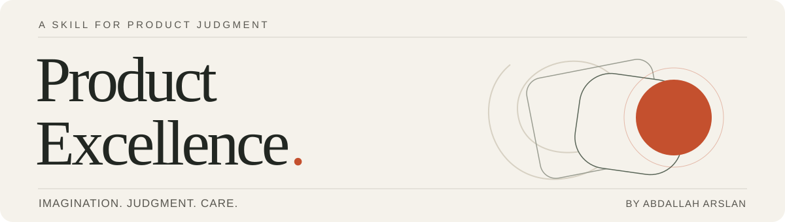

<p align="center">
  
</p>

# Make products worth choosing.

**A skill for product judgment, inventive design, and careful execution.**

Give your agent a product problem. Product Excellence gives it a practical way to explore a stronger idea, shape a coherent experience, and follow the work through to something people can actually use.

Inspired by Steve Jobs' product thinking: start with the experience, connect useful ideas, make deliberate choices, and care about the whole result. The [research](RESEARCH.md) separates historical evidence from the practical methods developed here.

**Experimental · Self-contained instructions · No runtime dependencies · MIT licensed**

[Try it](#try-it-without-installing) · [Install](#install) · [See the thinking](#what-it-brings-to-the-work) · [Read the evidence](EVALUATION.md)

## Try it without installing

Paste this into an agent that can open links, then replace the task:

```text
Read and apply Product Excellence:
https://raw.githubusercontent.com/aaarslan/product-excellence/main/product-excellence/SKILL.md

Task: Improve this product's first-use experience.
Choose a coherent direction, implement it in this repository,
and show what changed and what you checked.
```

For a review, say “review only; do not edit.” For a concept, describe the audience, observations, and constraints. You can use the skill with an existing app, a new idea, a developer tool, or a service.

If your agent cannot open the link, attach or paste [SKILL.md](product-excellence/SKILL.md). Everything needed to apply the skill is in that file. Reading it for a task does not install it.

## Install

With Node.js **22.20+** and npm, run this in your project:

```sh
npx skills add aaarslan/product-excellence --skill product-excellence
```

Choose your coding agent when prompted. This uses the third-party [Skills CLI](https://skills.sh/docs/cli); the skill itself needs no packages, API keys, or external services.

Then ask for real work:

| Agent | Example |
| --- | --- |
| Codex | `$product-excellence Make this onboarding experience worth finishing.` |
| Claude Code | `/product-excellence Make this onboarding experience worth finishing.` |

<details>
<summary><strong>Install manually, or ask Codex to install it</strong></summary>

In Codex, you can ask:

```text
$skill-installer install https://github.com/aaarslan/product-excellence/tree/main/product-excellence
```

For a manual install, [download the repository](https://github.com/aaarslan/product-excellence/archive/refs/heads/main.zip) or clone it:

```sh
git clone https://github.com/aaarslan/product-excellence.git
```

Copy the inner `product-excellence/` folder into one of these locations in your target project:

| Host | Project destination |
| --- | --- |
| Codex CLI / IDE | `.agents/skills/product-excellence/` |
| Claude Code | `.claude/skills/product-excellence/` |

Keep the folder's `SKILL.md`, `LICENSE`, and `agents/` metadata together. Check for an existing copy before replacing it. Remove that installed folder to uninstall a manual copy.

These are local coding-agent instructions. Chat products can have separate skill or plugin installation flows. See the current [Codex](https://learn.chatgpt.com/docs/build-skills) and [Claude Code](https://code.claude.com/docs/en/skills) documentation.

</details>

## What it brings to the work

| Habit | What the agent should do differently |
| --- | --- |
| **Find the promise** | Describe a concrete moment that should become easier, clearer, more capable, or more enjoyable. |
| **Explore a better mechanism** | Question an inherited step, borrow a useful idea from another field, or combine familiar parts into a better experience. |
| **Choose a direction** | Make one coherent recommendation, with a reason and an honest tradeoff. |
| **Give it character** | Make interaction, language, hierarchy, feedback, and visual detail serve the product's purpose. |
| **Complete the experience** | Carry the result through setup, use, recovery, and the next meaningful action where relevant. |
| **Let reality correct it** | Inspect the artifact, exercise the important behavior, and revise what does not work. |

A playful learning tool should have room for discovery and delight. A command-line tool may earn affection through excellent defaults and a clear recovery path. A community service may improve most by changing how the handover works. The skill does not prescribe one visual style or assume every problem needs more software.

For open briefs, it encourages invention. For a fixed design or tiny repair, it keeps the work bounded. There is no mandatory workshop, scorecard, business report, or framework recital.

## Good tasks to bring it

**Improve something real**

```text
$product-excellence This tool works, but using it feels like paperwork.
Improve the central interaction. Preserve saved work and existing useful
capabilities. Implement the result and inspect it at desktop and phone widths.
```

**Find a product worth testing**

```text
$product-excellence Here are observations, workarounds, and constraints
from a recurring problem. Recommend one product or service concept.
Make the experience concrete and explain what would change your mind.
```

**Get an opinionated critique**

```text
$product-excellence Review this experience using the actual artifact.
Show me the highest-value change, what already works, and a concrete
way to improve it. Review only; do not edit.
```

Replace the invocation with `/product-excellence` in Claude Code. Mechanical debugging, translation, and copy-only work stay small unless you explicitly request a product pass.

## Evidence you can inspect

The repository keeps the tasks, frozen instructions, outputs, and reviews behind its claims. The [evaluation report](EVALUATION.md) distinguishes comparative findings from implementation checks and from things that would require real users to establish.

One concrete result: in the visitor-guide prototype, replacing a blocked stop retains earlier activities and the original departure time, with an undo action. One blind reviewer preferred the revised skill's output to the committed skill's; another called a tie. The photo-service case also tied. The broader release gate remains unmet; the record supports a useful experimental direction, not a general performance advantage.

The [earlier public-code case study](CASE-STUDY.md) also retains an instructive failure: a skill-assisted improvement to JSON output introduced a numeric precision regression. The failed trial and the separately corrected demonstration are both preserved.

The purpose of evaluation is to find out when the skill helps, when a capable agent already does as well, and when the instructions need to change. This development study does not establish adoption, revenue, or a universal performance advantage.

## Contribute

Bring a concrete task where the skill helped, added nothing, or got in the way. [Contribution guidance](CONTRIBUTING.md) explains how to propose a small improvement and test it honestly.

Only the inner `product-excellence/` folder is installed. Research, examples, images, and evaluation material are optional reading for people.

## License and credits

Created by [Abdallah Arslan](https://github.com/aaarslan). The skill and original repository material are [MIT licensed](LICENSE). Historical sources retain their own rights. The existing Mr. Data Converter study retains its [upstream attribution and license notices](case-study/PROVENANCE.md).

An independent project inspired by product craft, with research and evaluation open to inspection.
